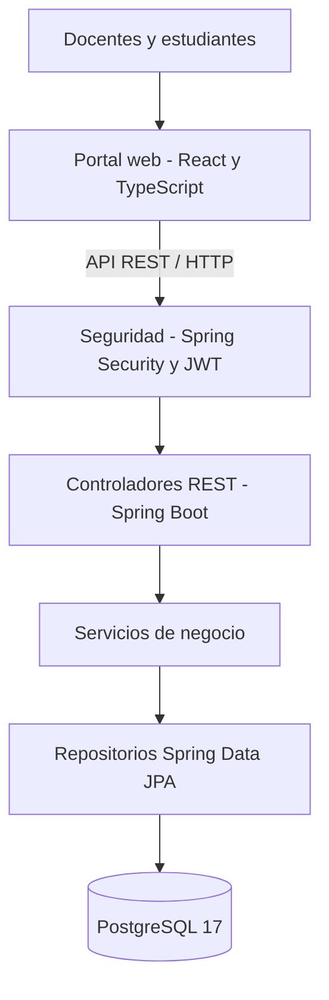

# Arquitectura del sistema — Attendance Registry

**Versión:** 2.0, sistema integrado y evaluado (9 de noviembre de 2026)  
**Asignatura:** Métricas y Estándares de Calidad — CORHUILA  
**Documentación:** José Miguel Aya Peralta; análisis de métricas: Luis Fernando Perez Chala.

## 1. Propósito y tipo de arquitectura

Attendance Registry (Att-book) gestiona cursos, sesiones, códigos QR y asistencias académicas. Utiliza una arquitectura **cliente-servidor**: un portal web consume una API REST. El backend es un **monolito modular organizado en capas** que centraliza reglas de negocio y persistencia.

La solución integrada incluye los módulos de identidad, cursos, sesiones, generación de códigos QR y asistencias. No son componentes pendientes de construcción dentro del alcance RF-01 a RF-10.

## 2. Justificación de las tecnologías

- **Java 17 y Spring Boot:** aplicación de reglas de negocio en clases y servicios; posibilidad de medición con PMD y CK, JUnit y Mockito.
- **React y TypeScript:** interfaz web para estudiantes y docentes; componentes verificables con Vitest y herramientas de análisis estático.
- **Spring Security y JWT:** autenticación y control de acceso a los endpoints.
- **Spring Data JPA:** acceso a datos y repositorios del backend.
- **PostgreSQL 17:** persistencia relacional de usuarios, cursos, sesiones, códigos QR y asistencia.
- **Docker Compose y Nginx:** reproducibilidad del entorno local y publicación del portal web.

La elección conserva el stack del proyecto original de Fullstack. Para este proyecto académico se evalúa principalmente la mantenibilidad del backend Java; el portal se verifica con pruebas y lint, pero no se incluye en la medición CK.

## 3. Diagrama de arquitectura

El portal envía las solicitudes HTTP. Spring Security verifica la autenticación y aplica las políticas correspondientes. Los controladores invocan servicios con reglas de negocio; los repositorios acceden a PostgreSQL.

## 4. Componentes y responsabilidades

| Capa o módulo | Componentes representativos | Responsabilidad | Estado |
|---|---|---|---|
| Portal | React, TypeScript | Registro, autenticación, cursos, sesiones, QR, asistencia e historial | Implementado |
| Identidad | `AuthController`, `IdentityService`, `SecurityConfig` | Usuarios, autenticación y roles | Implementado |
| Cursos | `CourseController`, `CourseService` | Crear, consultar y actualizar cursos | Implementado |
| Sesiones | `SessionController`, `SessionService` | Crear, modificar, consultar y eliminar sesiones con control de acceso | Implementado |
| QR | `QrController` y componentes en `academic/sessions/qr` | Generar y validar códigos temporales | Implementado |
| Asistencias | `AttendanceController`, `AttendanceService` | Registro mediante QR, detección de duplicados y consultas | Implementado |
| Persistencia | Repositorios JPA y entidades de dominio | Consultas, almacenamiento y asociaciones | Implementado |
| Infraestructura | Docker Compose, PostgreSQL, Nginx | Entorno local integrado | Implementado |

El código y las pruebas se encuentran principalmente en `sistema/att-book-api/src/main/java`, `sistema/att-book-api/src/test/java` y `sistema/att-book-portal`.

## 5. Trazabilidad arquitectónica

| Requisito | Módulo principal |
|---|---|
| RF-01 y RF-02 | Identidad y seguridad |
| RF-03 a RF-05 | Cursos |
| RF-06 y RF-07 | Sesiones |
| RF-08 | QR y sesiones |
| RF-09 | Asistencias, QR e inscripciones |
| RF-10 | Asistencias y sesiones |
| RNF-01 | Servicios y métodos Java evaluados por PMD |
| RNF-02 | Autenticación, autorización y controladores protegidos |
| RNF-03 | API REST y despliegue de prueba |

Consultar la [matriz completa de requisitos](../requisitos/requisitos.md) y las [pruebas de integración](../pruebas/integration-tests.md).

## 6. Decisiones, ventajas y compromisos

**Ventajas.** Las capas ayudan a localizar responsabilidades, aislar pruebas y aplicar refactorizaciones sin rediseñar toda la aplicación. El monolito modular es apropiado para el tamaño del proyecto y reduce la complejidad de despliegue frente a una arquitectura distribuida.

**Compromisos.** Un cambio en los contratos REST puede requerir ajustes en el portal. Los servicios y controladores pueden acumular responsabilidades y dependencias; la separación en capas no garantiza automáticamente bajo acoplamiento. La necesidad de manejar distintas herramientas para frontend y backend añade coordinación técnica.

## 7. Evolución y métricas de mantenibilidad

El análisis del backend se basó en **complejidad ciclomática (PMD), líneas de código (LOC) y CK**. Después de integrar el sistema, PMD informó tres métodos con V(G) superior a 10:

| Método | V(G) antes |
|---|---:|
| `SessionService.validateRequest` | 17 |
| `AttendanceService.registerAttendance` | 15 |
| `SessionService.requireCourseAccess` | 11 |

En el PR [#6](https://github.com/Jose-1206/attendance-registry-metricas/pull/6) se aplicó **Extract Method**, preservando las validaciones y la intención de las respuestas HTTP. El informe PMD posterior presenta **0 infracciones**, con pruebas automatizadas de asistencia incorporadas.

Las métricas CK muestran que esta mejora de complejidad local no equivale a una reducción de complejidad total por clase:

- `SessionService`: WMC 38 → 44 y LCOM* 0,694 → 0,796.
- `AttendanceService`: WMC 18 → 24 y LCOM* 0,520 → 0,764.
- `CourseController` y `SessionController`: CBO de 19 en la versión posterior.

Estos resultados justifican estudiar futuras separaciones de responsabilidades y simplificación de dependencias. Son señales de mantenibilidad, **no defectos de ejecución confirmados**. No se realizaron nuevas extracciones de clase en esta entrega.

## 8. Pruebas y alcance de la validación

El proyecto registra **10/10 requisitos funcionales aprobados** en pruebas manuales, **27/27 pruebas de frontend aprobadas** y **134/134 pruebas automatizadas de backend aprobadas** en el entorno configurado por el equipo. Para RNF-02 se documentaron 40 escenarios de seguridad aprobados; para RNF-03, una prueba de cuatro endpoints GET con k6 y P95 global de 110,85 ms.

Las pruebas de seguridad y carga se limitan a los escenarios documentados. No equivalen a una auditoría de seguridad integral ni a una evaluación de rendimiento en producción.

## 9. Próximas mejoras priorizadas

| Prioridad | Hallazgo | Posible mejora | Impacto esperado |
|---|---|---|---|
| Alta | WMC y LCOM* elevados en `SessionService` | Evaluar **Extract Class** y reorganizar responsabilidades | Mejor cohesión y distribución de métodos |
| Alta | WMC y LCOM* elevados en `AttendanceService` | Separar reglas de QR, autorización y registro cuando compense | Mejor modularidad |
| Media | CBO elevado en controladores | Revisar dependencias y reducir acoplamiento | Menor efecto de cambios entre módulos |
| Media | Pruebas de carga solo sobre GET | Ampliar escenarios de escritura y QR | Mayor confianza bajo otras cargas |
| Media | Advertencia de React y bundle de Vite | Revisar efecto de React y división del código | Mejor mantenibilidad y tamaño de carga |

El esfuerzo e impacto exactos de estas propuestas deben comprobarse mediante una nueva iteración de implementación y medición; no se presentan mejoras futuras como ya logradas.

## 10. Referencias de implementación

- [Informe comparativo de métricas](../metricas/informe-comparativo-final.md).
- [Requisitos y trazabilidad](../requisitos/requisitos.md).
- [Pruebas funcionales y de integración](../pruebas/integration-tests.md).
- [Origen y versiones de código](../integracion/versiones-origen.md).

**Estado:** arquitectura implementada y documentada según el repositorio académico integrado; se conservan oportunidades de evolución identificadas por CK y por el alcance limitado de algunas pruebas.
