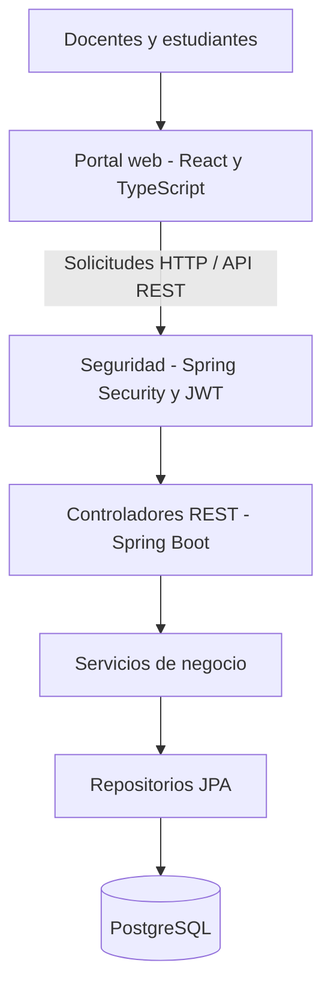

# Arquitectura del sistema — Attendance Registry

## 1. Introducción

Este documento presenta la arquitectura de software de Attendance Registry (Att-book), utilizado como base para el proyecto final de la asignatura Métricas y Estándares de Calidad.

La arquitectura permite identificar los componentes del sistema, sus responsabilidades, las relaciones entre módulos y su impacto sobre la mantenibilidad del código.

La descripción diferencia los componentes existentes en la versión revisada del proyecto Fullstack y los componentes pendientes para completar el alcance de Métricas.

## 2. Arquitectura seleccionada

Se selecciona una **arquitectura cliente-servidor con un backend monolítico modular organizado en capas**.

El sistema se compone de:

- Un portal web para la interacción con docentes y estudiantes.
- Una API REST encargada de atender las solicitudes.
- Una capa de servicios para procesar las reglas de negocio.
- Una capa de persistencia para acceder a los datos.
- Una base de datos relacional PostgreSQL.

El backend utiliza Java y Spring Boot. El portal utiliza React y TypeScript.

Esta combinación corresponde a las tecnologías encontradas en el proyecto original. Su conservación deberá ser validada con el docente, considerando el requisito académico de definir y justificar el lenguaje utilizado.

## 3. Justificación de la arquitectura

La arquitectura seleccionada se considera adecuada porque:

1. **Separación de responsabilidades:** permite distinguir la presentación, los controladores, la lógica de negocio y la persistencia.

2. **Mantenibilidad:** facilita identificar componentes que necesitan refactorización sin modificar necesariamente todas las capas.

3. **Organización modular:** permite agrupar las funcionalidades relacionadas con identidad, cursos, sesiones y asistencias.

4. **Facilidad para realizar pruebas:** los servicios y controladores pueden verificarse de forma independiente mediante pruebas unitarias y de integración.

5. **Reutilización:** permite aprovechar los componentes existentes de Attendance Registry y extender las funcionalidades pendientes.

6. **Análisis de calidad:** facilita aplicar métricas de complejidad, tamaño y diseño sobre clases y métodos concretos.

## 4. Diagrama de arquitectura

El diagrama representa la organización lógica de la aplicación.

El portal envía solicitudes a la API. Spring Security aplica las reglas de autenticación y autorización; las solicitudes permitidas son atendidas por controladores, servicios y repositorios.

## 5. Descripción de las capas

### 5.1. Capa de presentación

**Tecnología:** React y TypeScript.

Responsabilidades:

- Presentar las pantallas de la aplicación.
- Capturar y validar información de formularios.
- Consumir los endpoints de la API.
- Mostrar los resultados y mensajes al usuario.
- Administrar el estado de la interfaz.

En la versión revisada se encontraron pantallas de autenticación y gestión de cursos.

Las pantallas completas de sesiones, códigos QR y asistencias forman parte del alcance pendiente.

### 5.2. Capa de seguridad

**Tecnología:** Spring Security y JWT.

Responsabilidades:

- Validar la autenticación.
- Aplicar restricciones de acceso.
- Verificar los permisos según el rol.
- Proteger los recursos privados.

En el código revisado existe `SecurityConfig` y lógica relacionada con JWT.

La seguridad de los nuevos módulos deberá comprobarse mediante pruebas.

### 5.3. Capa de controladores

**Tecnología:** Spring Boot REST.

Responsabilidades:

- Recibir solicitudes HTTP.
- Aplicar validaciones de entrada.
- Invocar los servicios correspondientes.
- Devolver las respuestas y códigos HTTP.

Controladores identificados en la versión revisada:

- `AuthController`
- `CurrentUserController`
- `CourseController`

Los controladores de sesiones y asistencias se incorporarán durante el desarrollo pendiente.

### 5.4. Capa de servicios

Responsabilidades:

- Implementar las reglas de negocio.
- Coordinar las operaciones del sistema.
- Aplicar verificaciones y restricciones funcionales.
- Comunicarse con los repositorios de persistencia.

Servicios identificados:

- `IdentityService`
- `CourseService`

Se propone incorporar servicios para gestionar sesiones, códigos QR y asistencias.

### 5.5. Capa de persistencia

**Tecnología:** Spring Data JPA.

Responsabilidades:

- Consultar entidades.
- Guardar y actualizar registros.
- Ejecutar operaciones de persistencia.
- Mantener las relaciones entre entidades.

### 5.6. Base de datos

**Tecnología prevista:** PostgreSQL.

La versión revisada contiene entidades relacionadas con usuarios y cursos.

El alcance final también requiere persistir sesiones académicas, códigos QR y registros de asistencia.

Las migraciones y restricciones de base de datos se documentarán cuando sean implementadas.

## 6. Organización modular

La organización funcional del backend contempla los siguientes módulos:

| Módulo | Responsabilidad | Estado identificado |
|---|---|---|
| Identidad | Registro, autenticación, roles y usuarios | Implementado parcialmente |
| Cursos | Creación, consulta y actualización de cursos | Implementado |
| Sesiones | Creación y consulta de sesiones académicas | Pendiente |
| Códigos QR | Generación y validación de códigos temporales | Pendiente |
| Asistencias | Registro de asistencias y reportes | Pendiente |

Estos módulos corresponden a responsabilidades lógicas. Los nombres definitivos de paquetes y clases se establecerán durante la implementación.

## 7. Relación con los requisitos funcionales

| Requisito | Módulo principal |
|---|---|
| RF-01 | Identidad |
| RF-02 | Identidad y seguridad |
| RF-03 | Cursos |
| RF-04 | Cursos |
| RF-05 | Cursos |
| RF-06 | Sesiones |
| RF-07 | Sesiones |
| RF-08 | Códigos QR |
| RF-09 | Asistencias y códigos QR |
| RF-10 | Asistencias y reportes |

Esta relación será complementada con las clases, métodos y pruebas concretas cuando se complete la implementación.

## 8. Relación de la arquitectura con la mantenibilidad

La arquitectura permite evaluar la calidad del código a diferentes niveles.

### 8.1. Complejidad ciclomática

Se aplicará principalmente a los métodos de los controladores y servicios del backend.

Permitirá detectar métodos con un número elevado de decisiones, validaciones o caminos de ejecución.

### 8.2. Líneas de código

Se analizará el tamaño de las clases y métodos del backend, con especial atención a los componentes que concentren demasiadas responsabilidades.

### 8.3. Suite CK

Se utilizará para estudiar propiedades del diseño orientado a objetos, entre ellas:

- Complejidad ponderada de clases.
- Acoplamiento.
- Cohesión.
- Profundidad de herencia.
- Respuesta potencial de las clases.

Las métricas permitirán identificar posibles problemas de diseño y fundamentar propuestas de mejora.

## 9. Ventajas y compromisos de la arquitectura

### Ventajas

- Organización clara de responsabilidades.
- Posibilidad de realizar pruebas por componentes.
- Facilidad para localizar código que requiere mantenimiento.
- Reutilización de los componentes ya desarrollados.
- Posibilidad de evolucionar el sistema de forma progresiva.

### Compromisos

- Las modificaciones de contratos REST requieren coordinación entre el portal y la API.
- Una separación incorrecta entre capas puede aumentar el acoplamiento.
- El crecimiento del monolito requiere disciplina en la organización de módulos.
- La utilización de tecnologías diferentes en frontend y backend incrementa las herramientas que debe manejar el equipo.

## 10. Mejoras arquitectónicas por evaluar

Las siguientes son oportunidades de análisis y no defectos confirmados por métricas:

1. Revisar los métodos que concentren demasiadas validaciones.
2. Identificar clases con responsabilidades excesivas.
3. Evaluar las dependencias entre servicios.
4. Reducir duplicaciones cuando existan evidencias.
5. Mejorar la separación de responsabilidades en componentes extensos.
6. Incrementar las pruebas automatizadas de los módulos principales.

Las mejoras definitivas se seleccionarán después de obtener las mediciones iniciales.

## 11. Estrategia de evolución

El proceso de evolución seguirá las etapas:

1. Registrar el estado inicial del código.
2. Ejecutar las pruebas existentes.
3. Aplicar las métricas de mantenibilidad.
4. Detectar componentes que superen los umbrales.
5. Seleccionar mejoras justificadas.
6. Aplicar las refactorizaciones elegidas.
7. Ejecutar nuevamente las pruebas.
8. Comparar los valores antes y después.

El comportamiento funcional deberá conservarse durante las refactorizaciones.

## 12. Estado del documento

**Versión:** 1.0 — Arquitectura preliminar.

**Responsable de validación técnica:** Luis Fernando Perez Chala.

**Preparación inicial:** José Miguel Aya Peralta.

**Estado:** Pendiente de validación final contra el código integrado.

La documentación será actualizada cuando se incorporen los módulos de sesiones, QR y asistencias.