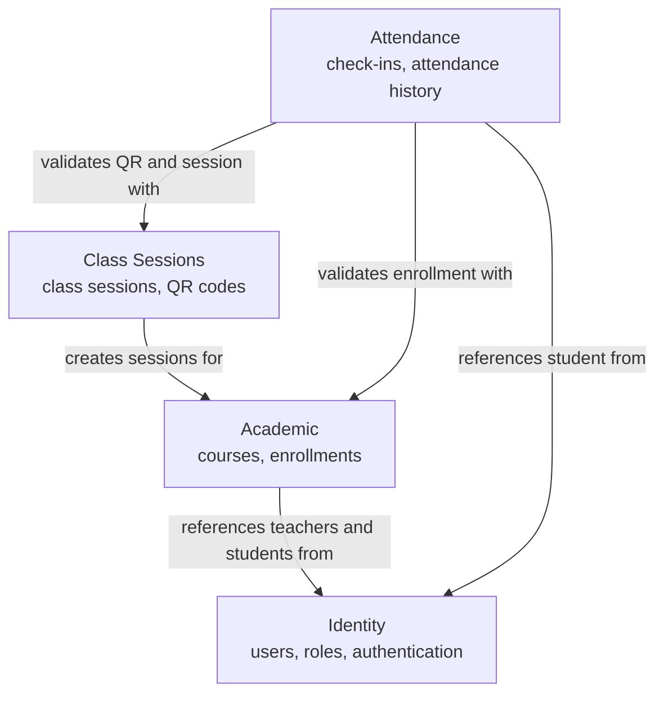

# 02 — Domain Map

## Bounded contexts

Attendance is organized into four bounded contexts: **Identity**, **Academic**, **Class Sessions**, and **Attendance**. Each context owns a specific part of the business domain and communicates with the others through clearly defined relationships.

The separation of these bounded contexts is based on the business responsibilities identified for Attendance and is documented in the architecture decision: [`ADR-002 — Attendance Module Boundaries`](../05-architecture/decisions/records/ADR-002-attendance-module-boundaries.md).

## Relationship legend

| Arrow | Meaning |
|---|---|
| `references teachers and students from` | The Academic context uses registered users and their roles to identify teachers and students associated with courses. This relationship follows the user role validation defined in **BR-01**. |
| `creates sessions for` | Each class session belongs to an existing course managed by the Academic context. A session can only be created when the related course already exists, according to **BR-04**. |
| `validates enrollment with` | Before recording attendance, the system verifies that the student is enrolled in the course associated with the class session, according to **BR-06**. |
| `validates QR and session with` | Attendance can only be recorded when the scanned QR code belongs to a valid class session and has not expired, according to **BR-05**. |
| `references student from` | The Attendance context references the student information required to create an attendance record. It does not modify Identity data; it only uses the registered user information. |

## Context responsibilities

| Context | Responsibility |
|---|---|
| **Identity** | Manages users, authentication, and the Student and Teacher roles. |
| **Academic** | Manages courses and the enrollment relationship between students and courses. |
| **Class Sessions** | Manages individual class sessions and the QR codes used to register attendance. |
| **Attendance** | Records student check-ins, stores attendance timestamps, prevents duplicate records, and provides attendance history. |

## Main domain flow

The main Attendance workflow is:

1. A **Teacher** manages a course.
2. Students are enrolled in the course.
3. The teacher creates a **Class Session**.
4. The system generates a QR code for that session.
5. A **Student** scans the QR code.
6. The system validates the QR code, class session, and student enrollment.
7. A new **Attendance** record is created with the check-in time.
8. The student can later view their attendance history.

## How this map is used

Every bounded context defined above becomes exactly one module in
[`module-boundaries.md`](./module-boundaries.md).

The entities and business rules associated with these contexts are defined in
[`entities-and-rules.md`](./entities-and-rules.md).

The architectural decision that defines these module boundaries is documented in
[`ADR-002 — Attendance Module Boundaries`](../05-architecture/decisions/records/ADR-002-attendance-module-boundaries.md).

---

**Related:** [`./entities-and-rules.md`](./entities-and-rules.md) · [`./module-boundaries.md`](./module-boundaries.md)
