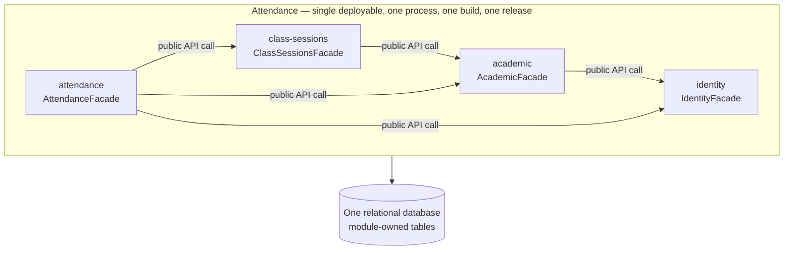

# 05 — Modular Monolith

## What it is

A **modular monolith** is one deployable, built and released as a unit, divided
inside into modules. Each module is a bounded context: it owns its tables,
exposes a narrow public API, and keeps everything else internal. Those three
terms are defined in
[`module-boundaries.md`](../02-domain/module-boundaries.md) and are used here
unchanged.

Attendance follows this architecture because the application contains different
business responsibilities that need clear boundaries while remaining part of
the same deployable application.

The modules defined for Attendance are `identity`, `academic`,
`class-sessions`, and `attendance`. Each module owns the data and behaviour
associated with its responsibility.

## One deployment, four modules

`identity`, `academic`, `class-sessions`, and `attendance` come directly from
the domain map and match the modules defined in
[`module-boundaries.md`](../02-domain/module-boundaries.md).

The `identity` module owns the information related to users and their roles.

The `academic` module owns courses and enrollments. It uses the public API of
`identity` when information about students or teachers is required.

The `class-sessions` module owns individual class sessions and their QR codes.
It depends on `academic` because every class session belongs to an existing
course.

The `attendance` module owns attendance records and check-in information. It
uses `identity` to reference the student, `academic` to validate course
enrollment, and `class-sessions` to validate the class session and QR code
before an attendance record is created.

All four modules are internal parts of the same Attendance application. They are
not independent services. Arrows cross a boundary only through a public API,
and dependencies never form a cycle.

A module never writes directly to data owned by another module. When information
from another module is required, communication must happen through that
module's public API.

The reasoning behind these module boundaries is documented in
[`ADR-002`](./decisions/records/ADR-002-attendance-module-boundaries.md).

## Anatomy of a module

| Part | Rule |
|---|---|
| Public API | One entry point, `<Module>Facade` — the only symbol other modules may import |
| Internal | Domain, application and persistence code; importable only from inside the module |
| Owned tables | Written by this module alone; others read them through the public API |
| Tests | `module-integration` tests exercise the public API; internals are covered by `unit` tests |

For Attendance, data ownership follows the domain boundaries:

| Module | Public API | Owned data |
|---|---|---|
| `identity` | `IdentityFacade` | users |
| `academic` | `AcademicFacade` | courses, enrollments |
| `class-sessions` | `ClassSessionsFacade` | class_sessions, qr_codes |
| `attendance` | `AttendanceFacade` | attendance_records |

This ownership keeps business responsibilities separated. For example,
`attendance` may validate information from `academic`, but it does not directly
modify courses or enrollments. In the same way, it may validate a QR code from
`class-sessions`, but the QR code remains owned by that module.

## How two modules talk, inside one process

| Mechanism | Use it when | What it is not |
|---|---|---|
| Public API call | The caller needs an answer now, inside the same transaction | Not a network hop — an ordinary in-process method call |
| In-process event | Two or more modules react to something that already happened | Not a broker or a queue — synchronous dispatch, same process, same release |

Both are plain function calls behind a boundary the build enforces. If a call
between modules starts needing a timeout or a retry policy, the boundary is in
the wrong place — the mechanism is not the problem.

In Attendance, the main interaction between modules happens when a student
scans a QR code to register attendance.

The `attendance` module can use the public APIs of the other modules to:

1. Reference the student through `identity`.
2. Validate that the student is enrolled in the corresponding course through
   `academic`.
3. Validate the class session and QR code through `class-sessions`.
4. Create the attendance record with the check-in time inside `attendance`.

This interaction happens inside the same application process. There are no
network calls between the modules because they belong to the same deployable.

The attendance record remains owned by the `attendance` module even though the
registration process requires information from the other modules.

## When it applies, and when it is over-engineering

| Situation | Verdict |
|---|---|
| Two or more bounded contexts on the domain map | Modular monolith |
| Two or more people changing unrelated business areas in the same week | Modular monolith |
| A business area that will outlive the current framework or database choice | Modular monolith |
| One bounded context on the domain map | Over-engineering — use [`layered-architecture.md`](./layered-architecture.md) |
| Boundaries drawn before the domain is understood | Over-engineering — the lines freeze in the wrong place |
| A folder per technical concern, called a module | Not a module at all; that is a layer |

Attendance has four bounded contexts: `identity`, `academic`,
`class-sessions`, and `attendance`, so the application uses a modular monolith.

These modules represent different business responsibilities while remaining
part of one application, one process, one build, and one release.

`identity` handles users, `academic` handles courses and enrollments,
`class-sessions` handles individual class sessions and QR codes, and
`attendance` handles the final attendance records.

The separation allows each module to own its data and business rules while
still allowing the complete attendance workflow to run inside a single
deployable application.

If the domain changes and these boundaries no longer represent the business
responsibilities of Attendance, the architecture can be revisited through a new
Architecture Decision Record.

---

**Related:** [`../02-domain/module-boundaries.md`](../02-domain/module-boundaries.md) · [`./boundary-enforcement.md`](./boundary-enforcement.md)
