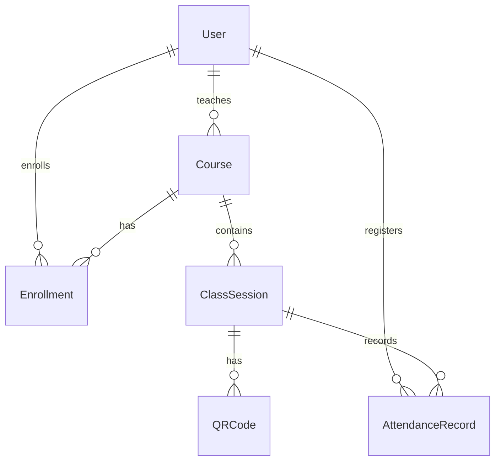

# 06 — Data Models

## Entities and ownership

The Attendance data model represents the business entities required for student attendance management through QR codes.

The application follows a modular monolith architecture with four modules: `identity`, `academic`, `class-sessions`, and `attendance`.

Entity ownership follows [`../02-domain/module-boundaries.md`](../02-domain/module-boundaries.md) and the domain definitions in [`../02-domain/entities-and-rules.md`](../02-domain/entities-and-rules.md).

| Entity | Owner module | Key attributes |
|---|---|---|
| User | `identity` | name, email, password hash, role |
| Course | `academic` | name, code, teacher reference |
| Enrollment | `academic` | student reference, course reference, enrollment date |
| ClassSession | `class-sessions` | course reference, date, start time, status |
| QRCode | `class-sessions` | session reference, token, expiration time, active |
| AttendanceRecord | `attendance` | student reference, session reference, check-in time |

These are logical domain entities. Physical PostgreSQL schema names, table names, primary keys, and column definitions must be validated against the backend persistence model and database migrations before being treated as implemented database structures.

Database naming and ownership conventions are documented in [`database-conventions.md`](./database-conventions.md).

## Relationships

The following diagram represents the logical relationships between the six domain entities.

The relationships follow these domain constraints:

- A course is associated with a registered teacher.
- An enrollment associates a student with a course.
- A student cannot be enrolled more than once in the same course.
- Every class session belongs to an existing course.
- Every QR code belongs to a specific class session and has an expiration time.
- An attendance record references a student and a class session.
- A student must be enrolled in the corresponding course before registering attendance.
- A student cannot register attendance more than once for the same class session.

The diagram represents logical associations and does not prescribe physical foreign keys across module boundaries.

## Module data ownership

| Module | Owned entities | Responsibility |
|---|---|---|
| `identity` | User | User accounts, authentication, and roles |
| `academic` | Course, Enrollment | Courses and student enrollments |
| `class-sessions` | ClassSession, QRCode | Class sessions and temporary QR codes |
| `attendance` | AttendanceRecord | Attendance registration and history |

Each module is responsible for managing its own data.

Modules must not directly modify data owned by another module. Cross-module interactions must follow the public API boundaries documented in [`../05-architecture/modular-monolith.md`](../05-architecture/modular-monolith.md).

## Business rules and data integrity

The model supports the business rules defined in [`../02-domain/entities-and-rules.md`](../02-domain/entities-and-rules.md).

| Rule | Data constraint |
|---|---|
| BR-01 | Only registered teachers can create and manage courses |
| BR-02 | Only students can be enrolled in courses |
| BR-03 | A student cannot be enrolled twice in the same course |
| BR-04 | Every class session belongs to an existing course |
| BR-05 | QR codes must belong to their session and must not be expired |
| BR-06 | Attendance requires enrollment in the corresponding course |
| BR-07 | Only one attendance record is allowed per student and class session |
| BR-08 | A successful attendance registration records the check-in time |

These constraints describe the required business behavior. Their implementation through application validation, database constraints, or both must be verified against the backend.

---

**Related:** [`../02-domain/entities-and-rules.md`](../02-domain/entities-and-rules.md) · [`../02-domain/module-boundaries.md`](../02-domain/module-boundaries.md) · [`./database-conventions.md`](./database-conventions.md) · [`./migrations.md`](./migrations.md)
