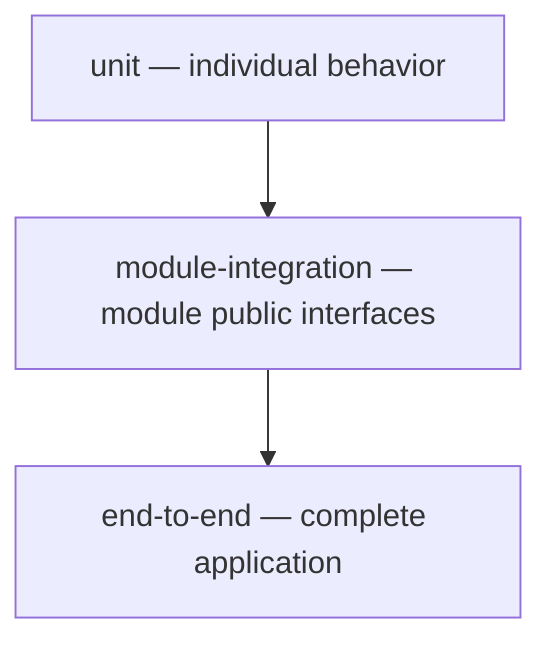

# 11 — Testing Strategy

> [!NOTE] INSTRUCTIONS
> Keep this block until the test stage in ci-cd.md enforces the documented
> coverage threshold and the corresponding execution evidence is available.

## Purpose

This strategy defines the documented testing layers for Attendance Registry.

The existence of this strategy does not demonstrate that tests, coverage
gates, or CI jobs have been implemented or have passed.

## The pyramid, shaped by module boundaries



Module integration tests verify behavior through the module's public
interfaces while respecting the boundaries documented in
[boundary-enforcement.md](../05-architecture/boundary-enforcement.md).

A test that accesses another module's internal implementation does not
demonstrate compliance with those boundaries.

## Layers

| Layer | What it covers | What it does not cover | Documented target |
|---|---|---|---|
| `unit` | One class or function inside a module, with collaborators replaced by test doubles. | Real database integration or interactions between modules. | At least 80% automated test coverage on changed backend files — NFR-08. |
| `module-integration` | A module's public API called from outside the module, against a real database. | Direct access to another module's internal implementation. | Every BR-NN reachable through a public interface has at least one test. |
| `end-to-end` | The complete application through its HTTP API. | Load and concurrency measurements, which require separate verification. | Every priority HU-NN marked with a star has at least one test. |

Coverage is evaluated through the combined applicable test execution.
The percentage is a target until supported by a coverage report.

## Naming a test

Use:

```text
<subject>_<condition>_<expectedResult>
```

For example:

```text
registerAttendance_whenAlreadyRegistered_isRejected
```

This example corresponds to the duplicate-prevention behavior in BR-07.
It illustrates naming and does not claim that this exact test exists
or has passed.

The name states the expected behavior; assertions verify that behavior.

## Where each layer runs

The documented execution arrangement is:

| Layer | Intended execution point |
|---|---|
| `unit` | The CI test stage on pull requests. |
| `module-integration` | The CI test stage on pull requests. |
| `end-to-end` | Verification of the deployed application in the target test environment. |

This arrangement must be checked against the actual pipeline configuration
in each repository.

Configured jobs, successful executions, coverage enforcement, and deployment
checks require their own evidence. They are not established by this document.

See [CI/CD pipeline](../10-devops/ci-cd.md).

## Requirement references

- NFR-01 defines the API performance target.
- NFR-04 defines rejection of missing, invalid, or expired JWTs.
- NFR-05 defines role-based authorization checks.
- NFR-06 defines attendance integrity and QR rejection behavior.
- NFR-07 concerns dependency security.
- NFR-08 defines automated backend test coverage.

The authoritative thresholds remain in
[non-functional requirements](../04-requirements/non-functional.md).

This strategy does not change those thresholds.

## Verification evidence

A test requirement remains a target until its execution result is available.

When reporting results, identify the tested revision, execution command,
environment, and resulting report.

Do not mark a requirement as verified solely because a test is described
or a test file exists.

## Related documents

- [CI/CD pipeline](../10-devops/ci-cd.md)
- [Traceability matrix](../04-requirements/traceability-matrix.md)
- [Non-functional requirements](../04-requirements/non-functional.md)
- [Boundary enforcement](../05-architecture/boundary-enforcement.md)
