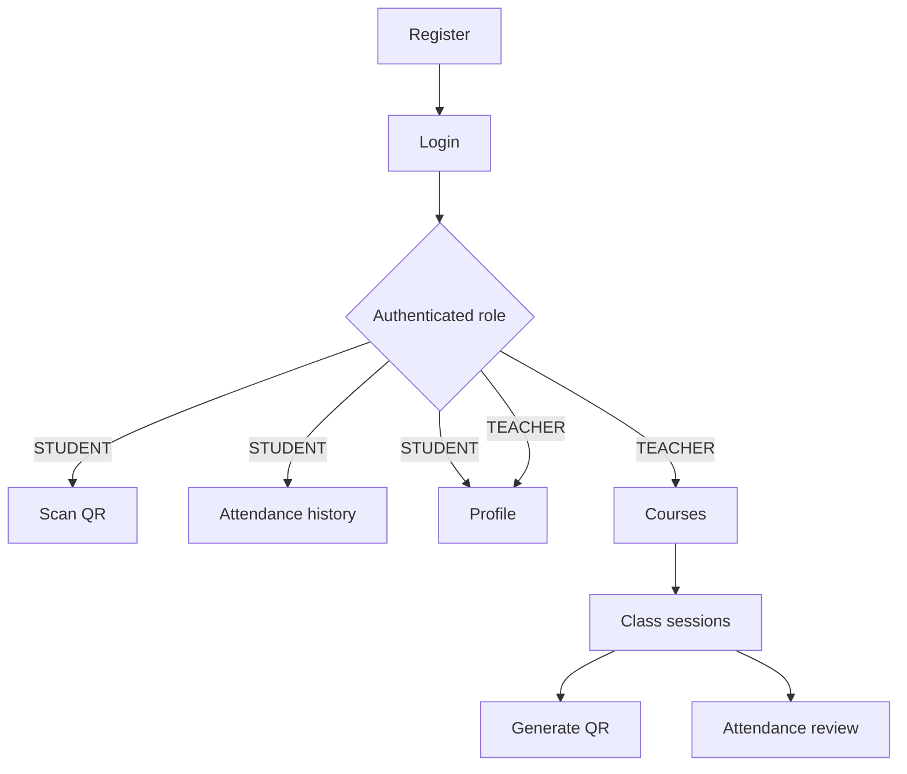

# 12 — UX/UI

## Purpose

This section defines the user-interface decisions for the **Attendance** mobile
application. It documents the shared visual rules, reusable components, screen
states, validation feedback, and accessibility expectations used by students
and teachers throughout the attendance workflow.

**Applies to this system:** yes — Attendance is a mobile application with
role-based screens for `STUDENT` and `TEACHER` users.

## UX scope

The interface follows the product scope defined in
[`../01-context/scope.md`](../01-context/scope.md).

The main Attendance workflow is:

**Authentication → Course → Class Session → QR Code → Attendance → History/Review**

The UX/UI documentation covers only capabilities already defined in the
Attendance requirements.

The following capabilities remain outside the current UX scope:

- biometric attendance;
- mandatory GPS validation;
- offline attendance registration;
- grade management;
- push notifications;
- automatic university-system integration;
- multi-institution administration.

## User roles

| Role | Main interface capabilities |
|---|---|
| `STUDENT` | Register, log in, view profile, scan a class QR code, receive attendance feedback, and review personal attendance history. |
| `TEACHER` | Register, log in, view profile, create and view courses, create and view class sessions, generate temporary QR codes, and review attendance for a class session. |

## Documents

| Document | Answers | Related requirements | Priority |
|---|---|---|---|
| [design-system.md](./design-system.md) | What visual, component, feedback, and accessibility rules do Attendance screens share? | NFR-10 | ⭐ |
| [register-screen.md](./register-screen.md) | How does a new student or teacher create an account? | HU-01 | ⭐ |
| [login-screen.md](./login-screen.md) | How does an existing user authenticate? | HU-02 | ⭐ |
| [profile-screen.md](./profile-screen.md) | How does an authenticated user view their own account information? | HU-03 | — |
| [courses-screen.md](./courses-screen.md) | How does a teacher create and view courses? | HU-04, HU-05 | ⭐ |
| [class-sessions-screen.md](./class-sessions-screen.md) | How does a teacher create and view class sessions for a course? | HU-06, HU-07 | ⭐ |
| [qr-code-screen.md](./qr-code-screen.md) | How does a teacher generate and display a temporary QR code? | HU-08 | ⭐ |
| [scan-qr-screen.md](./scan-qr-screen.md) | How does a student scan a QR code and receive check-in feedback? | HU-09 | ⭐ |
| [attendance-history-screen.md](./attendance-history-screen.md) | How does a student review personal attendance records? | HU-10 | ⭐ |
| [attendance-review-screen.md](./attendance-review-screen.md) | How does a teacher review attendance for one class session? | HU-11 | ⭐ |
| [_template-screen.md](./_template-screen.md) | Template used when a new Attendance screen is documented. It is not edited in place. | — | — |

## Navigation model

Navigation is role-based after authentication.

A student receives access only to the attendance actions assigned to the
`STUDENT` role, while a teacher receives access to course, class-session, QR,
and attendance-review operations.

The interface must not present teacher-only operations as available student
actions or student attendance registration as a teacher operation.

Backend JWT validation and role authorization remain authoritative even when an
action is hidden in the UI.

## Shared screen states

Screens that communicate with the backend must define the following states when
applicable:

- **Loading:** the application is waiting for backend data.
- **Empty:** the request succeeded but no records exist.
- **Error:** the operation failed and a human-readable message is shown.
- **Ready/Populated:** valid data is available and the user can continue.
- **Submitting:** a create or update request is in progress.
- **Success:** a requested operation was confirmed by the backend.

The interface must prevent duplicate submissions while a request is already
being processed.

## Attendance-specific feedback

The student attendance flow must represent the real domain outcomes documented
in [`../02-domain/entities-and-rules.md`](../02-domain/entities-and-rules.md).

| Business rule | UI outcome |
|---|---|
| `BR-05` | Invalid or expired QR code is rejected. |
| `BR-06` | A student who is not enrolled in the course cannot register attendance. |
| `BR-07` | Duplicate attendance for the same class session is rejected. |
| `BR-08` | Successful attendance stores and displays the check-in time when available. |

The application must not display a successful attendance state until the
backend confirms that the attendance record was created.

## Accessibility and usability target

The interface targets **WCAG 2.1 AA** principles for contrast, labels, focus,
error feedback, and color-independent status communication.

The student QR flow must also support **NFR-10**:

> At least 90% of first-time test users should complete the student QR check-in
> flow in 30 seconds or less without assistance.

The scan flow therefore keeps the primary action simple:

1. open the QR scanner;
2. scan the QR generated by the teacher;
3. wait for backend validation;
4. receive immediate success or rejection feedback.

## Out of scope

This section does not define:

- a micro-frontend architecture;
- multiple independently deployed user interfaces;
- a backend-for-frontend service;
- capabilities outside the documented Attendance MVP.

Attendance uses one mobile client that communicates with the application API
documented in [`../07-api/README.md`](../07-api/README.md).

## Ready when

- [x] The section represents the Attendance project rather than generic template examples.
- [x] Student and teacher flows match the documented roles.
- [x] Every current screen is linked to its real `HU-NN`.
- [x] QR and attendance states match the documented business rules.
- [x] No screen introduces capabilities outside the project scope.
- [x] Accessibility and QR usability expectations are documented.
- [x] `_template-screen.md` remains unchanged.

---

**Related:** [`../04-requirements/README.md`](../04-requirements/README.md) · [`../02-domain/entities-and-rules.md`](../02-domain/entities-and-rules.md) · [`../01-context/scope.md`](../01-context/scope.md)
